# 📊 Awesome SaaS &amp; Business Performance Metrics 🚀

> **The definitive curated directory of SaaS revenue analytics, subscription business intelligence, and financial health metrics platforms.**  
> Track **Monthly Recurring Revenue (MRR)**, **Annual Recurring Revenue (ARR)**, **Customer &amp; Revenue Churn**, **Customer Lifetime Value (LTV)**, and unit economics with hosted enterprise platforms and open-source, self-hosted tools.

🌟 **Star this repository if you find it helpful for your SaaS financial stack!** 🌟

---

## 📑 Table of Contents

- [🌐 Sector Overview &amp; Market Dynamics](#-sector-overview--market-dynamics)
- [🏢 SaaS / Hosted Commercial Platforms](#-saas--hosted-commercial-platforms)
- [💻 Open-Source &amp; Self-Hosted Software](#-open-source--self-hosted-software)
- [⚖️ Feature &amp; Capability Comparison](#-feature--capability-comparison)
- [💡 Key SaaS Metrics Formula Cheat Sheet](#-key-saas-metrics-formula-cheat-sheet)
- [💖 Support](#-support)
- [🤝 Contributing Guidelines](#-contributing-guidelines)
- [📈 Star History](#-star-history)
- [📜 License](#-license)

---

## 🌐 Sector Overview &amp; Market Dynamics

> 💡 **Market Size &amp; Growth**: The global SaaS business and subscription analytics market is valued between **$14B and $16B+**, growing rapidly at a compound annual growth rate (**CAGR of ~14–15%**) toward an estimated **$40B–$60B** over the next decade as cloud subscription business models continue to dominate software delivery.
> 
> 🧩 **Market Fragmentation**: The sector is **moderately fragmented**: specialized niche tools thrive by offering targeted billing and subscription metric calculations (e.g., automated MRR waterfalls, cohort retention, and dunning workflows), while massive enterprise cloud conglomerates (e.g., Salesforce/Tableau, Microsoft Power BI, Stripe) maintain heavy concentration across core enterprise data pipelines and billing rails.

---

## 🏢 SaaS / Hosted Commercial Platforms

Commercial, turnkey subscription analytics and business intelligence solutions. The table below is sorted by **Company Size / Valuation (Descending)**.

| 🏢 Platform | 💰 Company Valuation / ARR | 🏷️ Starting Paid Tier | 🎁 Free Tier / Free Trial Limits | 🎯 Primary Focus &amp; Key Capabilities |
| :--- | :--- | :--- | :--- | :--- |
| **[Stripe Sigma](https://stripe.com/sigma)** | **$159.0B Valuation** (~$6.8B Rev) | **$10/month** (up to 250 charges) + $0.02/extra charge | **30-Day Free Trial**; unlimited test queries in Stripe Sandbox | In-dashboard SQL reporting engine with AI query assistant running directly on live Stripe payment &amp; charge logs. |
| **[ProfitWell Metrics](https://www.profitwell.com/recur/metrics)** | **$200.0M Acquired** (by Paddle, $1.4B Val) | **$0/month** (Core Metrics free; monetizes on Paddle Merchant of Record &amp; add-ons) | **100% Free Forever** (Unlimited revenue tracking, churn analytics, cohorts, and benchmarks for 15,000+ companies) | Standardized financial subscription metrics, cohort retention curves, benchmark comparisons, and zero tracking fees. |
| **[ChartMogul](https://chartmogul.com)** | **~$10.0M ARR** (Private / Bootstrapped) | **$57/month** (billed annually) for >$10K MRR | **Free Forever up to $10,000 MRR** ($120K ARR limit); 14-day free trial on higher tiers | Automated subscription analytics consolidating Stripe, Chargebee, Recurly, and App Store data into real-time MRR waterfalls and B2B CRM. |
| **[Databox](https://databox.com)** | **~$8.4M ARR** (~$4.8M funding) | **$71/month** (billed annually for Starter plan) | **Free Forever Plan** (Limited to 3 data sources, 1 dashboard, 10 custom metrics, 1 user, daily syncs) | Multi-source KPI executive dashboard integrating Stripe, Google Analytics, CRM, and databases into unified TV/mobile dashboards. |
| **[Baremetrics](https://baremetrics.com)** | **$4.0M Acquired** (by Xenon Partners) | **$49/month** (billed annually for Launch plan up to $360K ARR) | **14-Day Free Trial** with full feature access and unlimited integrations (no permanent free plan) | Clean, founder-friendly subscription metrics tracking 28+ KPIs with integrated payment recovery (Recover) and cancellation surveys. |
| **[Geckoboard](https://www.geckoboard.com)** | **~$3.5M ARR** (~$1.5M funding) | **$60/month** (billed annually for Essential plan) | **14-Day Free Trial** including 1 dashboard &amp; 1 edit seat (no permanent free plan) | Real-time TV KPI metric boards designed for team dashboards, integrating payment, CRM, and server metrics with Slack broadcast loops. |

---

## 💻 Open-Source &amp; Self-Hosted Software

Self-hosted, transparent, and developer-friendly alternatives to proprietary subscription analytics tools. Projects below are sorted by **GitHub Stars (Descending)**.

| 📦 Repository | ⭐ Stars | 🛠️ Tech Stack | 📜 License | 🎯 Description &amp; Highlights |
| :--- | :--- | :--- | :--- | :--- |
| **[Lago](https://github.com/getlago/lago)** |  | Ruby / Go / React | AGPL-3.0 | Open-source meter-based usage and subscription billing infrastructure. Provides raw event metering, invoice generation, customer usage analytics, and native MRR tracking. |
| **[Kill Bill](https://github.com/killbill/killbill)** |  | Java / OSGi | Apache 2.0 | Battle-tested enterprise open-source subscription management and payment orchestration engine with built-in financial reporting, invoice metrics, and audit logs. |
| **[Chartbrew](https://github.com/chartbrew/chartbrew)** |  | Node.js / React / PostgreSQL | Apache 2.0 | Open-source BI reporting platform to build live KPI dashboards from SQL/NoSQL databases, Stripe, and ChartMogul APIs with an embedded AI chart builder. |
| **[Socketkit](https://github.com/anonrig/socketkit)** |  | Go / gRPC | MIT | Open-source alternative to ChartMogul and SensorTower for mobile app developers; syncs with App Store Connect to report MRR, ARPU, currency conversion, and churn. |
| **[Pulse](https://github.com/mike-paper/pulse)** |  | TypeScript / Next.js | MIT | Modern open-source SaaS metrics application built to ingest billing webhooks and produce instant churn, growth, and recurring revenue dashboards. |
| **[Twitter Stripe MRR](https://github.com/jsjoeio/twitter-stripe-mrr)** |  | Node.js / JavaScript | MIT | Automated build in public utility that calculates real-time net Monthly Recurring Revenue via the Stripe API and keeps social profiles or status dashboards updated. |
| **[dbt-stripe](https://github.com/fivetran/dbt_stripe)** |  | SQL / dbt | Apache 2.0 | Industry-standard open-source dbt package that models raw Stripe billing datasets into data warehouse tables for Daily MRR, Churn, Active Subscriptions, and LTV. |
| **[Revenut](https://github.com/hbcondo/revenut-app)** |  | FastAPI / React Native (PWA) | Apache 2.0 | Lightweight mobile &amp; web revenue forecasting app for Stripe that excludes fraud and card testing charges while calculating unrealized upcoming invoice MRR. |
| **[SaaSBoard](https://github.com/MekuHQ/saasboard)** |  | React / Vite / Tailwind CSS | MIT | Clean, responsive open-source SaaS dashboard template featuring ready-to-wire cards for MRR, active users, subscription distribution, and churn charts. |
| **[MRRmaid](https://github.com/ctrlaltdylan/MRRmaid)** |  | Go / Terminal TUI | MIT | Terminal CLI dashboard for indie hackers tracking MRR, Net Revenue Retention (NRR), customer churn, and customer concentration across Stripe and Shopify Partners. |
| **[MRR Growth Dashboard](https://github.com/suzuki-429/MRR-Growth-Analytics-Dashboard)** |  | React 19 / Express / PostgreSQL | MIT | Monorepo boilerplate for indie developers featuring full CRUD for monthly subscription revenue, automatic Net MRR growth calculation, and interactive charts. |
| **[stripemetrics](https://github.com/igorbenav/stripemetrics)** |  | Python | MIT | Simple, scriptable Python library to pull transactions directly from the Stripe API and extract MRR breakdown, customer counts, and churn curves. |
| **[ChurnLens](https://github.com/kindrat86/churnlens)** |  | Python / Docker | COCL v1.0 | Self-hosted CLI and MCP server that computes SaaS revenue-quality, cohort churn risk, and customer lifetime value from CSV or Stripe exports. |
| **[SaaSDashboard](https://github.com/bhattsaurya16/SaaSDashboard)** |  | Python / Streamlit / Gemini AI | MIT | AI-powered analytics dashboard for customer CSV datasets offering MRR movement breakdown, churn risk factors, and automated Gemini AI strategic insights. |

---

## ⚖️ Feature &amp; Capability Comparison

| Solution | Deployment | Primary Billing Sources | Real-Time MRR | Churn Analysis | Cohort Retention | AI / SQL Assistant | Self-Hosted |
| :--- | :--- | :--- | :---: | :---: | :---: | :---: | :---: |
| **ChartMogul** | Hosted Cloud | Stripe, Chargebee, Recurly, Braintree, PayPal, App Store | ✅ | ✅ | ✅ | ❌ | ❌ |
| **Baremetrics** | Hosted Cloud | Stripe, Braintree, Recurly, App Store | ✅ | ✅ | ✅ | ❌ | ❌ |
| **ProfitWell** | Hosted Cloud | Stripe, Braintree, Paddle, Chargebee, Zuora | ✅ | ✅ | ✅ | ❌ | ❌ |
| **Stripe Sigma** | Hosted Cloud | Stripe Only | ✅ | ✅ | ✅ | ✅ (AI SQL) | ❌ |
| **Databox** | Hosted Cloud | 100+ Connectors (Stripe, HubSpot, GA4) | ✅ | ✅ | ⚠️ (Basic) | ❌ | ❌ |
| **Geckoboard** | Hosted Cloud | 80+ Connectors (Stripe, Spreadsheets) | ✅ | ⚠️ (Basic) | ❌ | ❌ | ❌ |
| **Lago** | Self-Hosted / Cloud | Native Engine + Payment Gateways | ✅ | ✅ | ✅ | ❌ | ✅ |
| **Kill Bill** | Self-Hosted | Multi-Payment Gateway (Stripe, Adyen, PayPal) | ✅ | ✅ | ⚠️ (Plugins) | ❌ | ✅ |
| **Chartbrew** | Self-Hosted / Cloud | Stripe, ChartMogul, SQL, Mongo, APIs | ✅ | ✅ | ⚠️ (Custom) | ✅ | ✅ |
| **dbt-stripe** | Warehouse (dbt) | Stripe Raw Data | ✅ | ✅ | ✅ | ❌ | ✅ |
| **Pulse** | Self-Hosted | Stripe / Webhooks | ✅ | ✅ | ⚠️ (Basic) | ❌ | ✅ |
| **Revenut** | Self-Hosted | Stripe API | ✅ | ⚠️ (Forecast) | ❌ | ❌ | ✅ |
| **SaaSDashboard** | Self-Hosted | CSV / SQL / Database | ✅ | ✅ | ✅ | ✅ (Gemini) | ✅ |

---

## 💡 Key SaaS Metrics Formula Cheat Sheet

Here is a quick reference for the mathematical definitions of the core business metrics tracked across these platforms:

- **Monthly Recurring Revenue (MRR)**:
  $$\text{MRR} = \sum (\text{Active Paying Customers} \times \text{Monthly Subscription Price})$$
- **Net New MRR**:
  $$\text{Net New MRR} = \text{New MRR} + \text{Expansion MRR} - \text{Contraction MRR} - \text{Churned MRR}$$
- **Annual Recurring Revenue (ARR)**:
  $$\text{ARR} = \text{MRR} \times 12$$
- **Gross Customer Churn Rate**:
  $$\text{Customer Churn Rate (\%)} = \left( \frac{\text{Customers Lost in Period}}{\text{Total Customers at Start of Period}} \right) \times 100$$
- **Net Revenue Retention (NRR)**:
  $$\text{NRR (\%)} = \left( \frac{\text{Starting MRR} + \text{Expansion} - \text{Contraction} - \text{Churn}}{\text{Starting MRR}} \right) \times 100$$
- **Customer Lifetime Value (LTV)**:
  $$\text{LTV} = \frac{\text{Average Revenue Per User (ARPU)}}{\text{User Churn Rate}}$$
- **LTV to CAC Ratio**:
  $$\text{Efficiency} = \frac{\text{LTV}}{\text{Customer Acquisition Cost (CAC)}} \quad (\text{Target: } \ge 3.0\times)$$

---

## 💖 Support

Thank you so much for exploring and supporting this curated resource! 🙏  
If you find this repository valuable for tracking your business metrics, building SaaS analytics, or exploring open-source financial tools, please consider supporting the project:

- ⭐ **Star** this repository on GitHub to help others discover it.
- 🍴 **Fork** it and submit tools or improvements to grow the list.
- 📢 **Share** it with fellow founders, finance teams, indie hackers, and SaaS developers.
- ☕ **Buy me a coffee**: If you'd like to support ongoing curation and maintenance, consider sponsoring via the **[GitHub Sponsors Dashboard](https://github.com/sponsors/ishandutta2007)**!

---

## 🤝 Contributing Guidelines

Contributions, suggestions, and corrections are warmly welcome! 💖

1. **Fork the repo** and create your branch: `git checkout -b feature/new-saas-tool`
2. **Add tool details** following the existing format:
   - Name &amp; repository or product link
   - Precise pricing / Free tier limit (no generic placeholders)
   - GitHub star count badge (for open-source tools, style=social and color=white)
   - Tech stack and license
3. **Open a Pull Request** with a brief summary of why the tool is a great addition to the ecosystem.

---

##  Star History

---

## 📜 License

This compilation is licensed under the [Creative Commons Zero v1.0 Universal](LICENSE) (CC0 1.0 - Public Domain Dedication).  
Individual tools and software listed retain their respective copyrights and licenses.

---

**[⬆ Back to Top](#-awesome-saas--business-performance-metrics-)**

